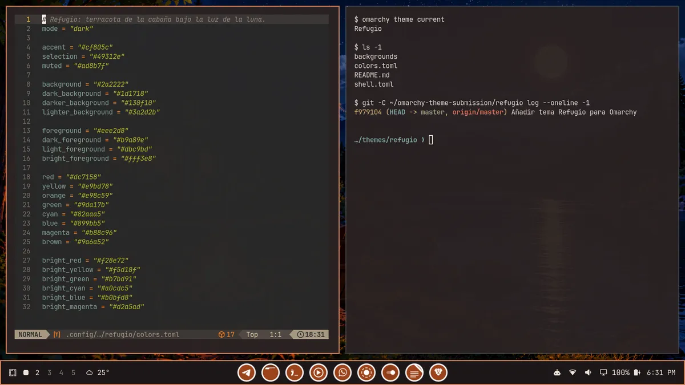

# Refugio

Un tema oscuro para [Omarchy](https://omarchy.org/) inspirado en una cabaña
junto al lago bajo la luz de la luna: superficies de terracota y pizarra, texto
crema y acentos de fuego, cobre y luz dorada.



## Instalación

```bash
omarchy theme install https://github.com/jandydisla/refugio.git
omarchy theme set refugio
```

O copia manualmente esta carpeta a `~/.config/omarchy/themes/refugio` y ejecuta
`omarchy theme set refugio`.

## Contenido

- `colors.toml` — paleta del tema.
- `shell.toml` — barra, bordes y controles del shell de Omarchy.
- `backgrounds/` — dos fondos de escritorio originales (atardecer y luna
  llena). Cámbialos con `omarchy theme bg next` o `omarchy theme bg set`.

## Créditos

Paleta y fondos creados por el autor del tema.
